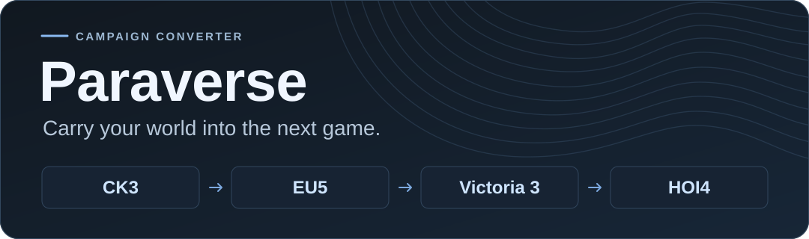

  <strong><a href="https://github.com/chuppka/Paraverse-Releases/releases/download/v1.0/Paraverse-1.0.exe">Download for Windows</a></strong> ·
  <a href="https://github.com/chuppka/Paraverse-Releases/releases/tag/v1.0">v1.0 release notes</a> ·
  <a href="https://discord.gg/xJDxqVY6hM">Join Discord</a>

Paraverse turns a save from one Paradox game into a starting mod for the next. Carry a campaign from **Crusader Kings III → Europa Universalis V → Victoria 3 → Hearts of Iron IV**, or go straight from CK3 to Victoria 3.

## Quick start

1. Download and run `Paraverse-1.0.exe`. Have the source and destination games installed. The app works offline and includes its save-reading tools.
2. Drop your save into the window, choose a file, or select a game and click **Add latest save**. Choose the destination and confirm the game folders.
3. Review the campaign, click **Create mod**, then **Install mod**. In EU5, enable the mod under **Mods & DLC**. For Victoria 3 and HOI4, click **Open launcher** and enable it in a Paradox Launcher playset.
4. Start a **new campaign** with the mod enabled. For the next transfer, save that campaign in the game and open the save in Paraverse.

## Supported routes

| Route | What carries over | New start |
| --- | --- | --- |
| CK3 → EU5 | Countries, borders, capitals, faiths, cultures, flags, rulers and their families, professional regiments, settlements and supported buildings | 1337 |
| CK3 → Victoria 3 | Countries, borders, cultures, religions, rulers and flags. Average development helps determine starting status. | 1836 |
| EU5 → Victoria 3 | Countries, borders, population, cultures, religions, selected buildings and laws, colonial activity and fleets. Capital development helps determine starting status. | 1836 |
| Victoria 3 → HOI4 | Countries, borders, flags, rulers, ideology, stability, advisors, subject relationships, industry, divisions and ships. Countries can receive up to six focuses for their strongest land neighbors. | 1936 |

## Game versions and saves

| Game | Version used for development | Save format |
| --- | --- | --- |
| Crusader Kings III | 1.20.0.2 | Manual `.ck3` save with a text `gamestate` |
| Europa Universalis V | 1.3.8 | Text or supported binary `.eu5` |
| Victoria 3 | 1.12.4 | Text or supported binary `.v3` |
| Hearts of Iron IV | 1.19.2.0 | Destination only |

Other patches and mods can change the map or save format. The wizard shows version warnings when it can identify the game version. Borders, economies and mechanics are adapted to the destination game. The conversion report records approximations, substituted flags and skipped items. Your original save stays in place.

## Report a problem

Open **Details → Copy diagnostics**, then include that text, the conversion route, and the steps that reproduce the problem in a [GitHub issue](https://github.com/chuppka/Paraverse-Releases/issues/new). The copied diagnostics mask local file paths and the save filename.

## Credits

Paraverse uses province mappings from the Paradox Game Converters projects [CK3toEU5](https://github.com/ParadoxGameConverters/CK3toEU5), [EU5ToVic3](https://github.com/ParadoxGameConverters/EU5ToVic3) and [Vic3ToHoI4](https://github.com/ParadoxGameConverters/Vic3ToHoI4), along with [Rakaly CLI](https://github.com/rakaly/cli) for supported binary saves. Third-party license notices are included in the app package.

Paraverse is an independent community project. You can support its development on [Ko-fi](https://ko-fi.com/chuppka).
